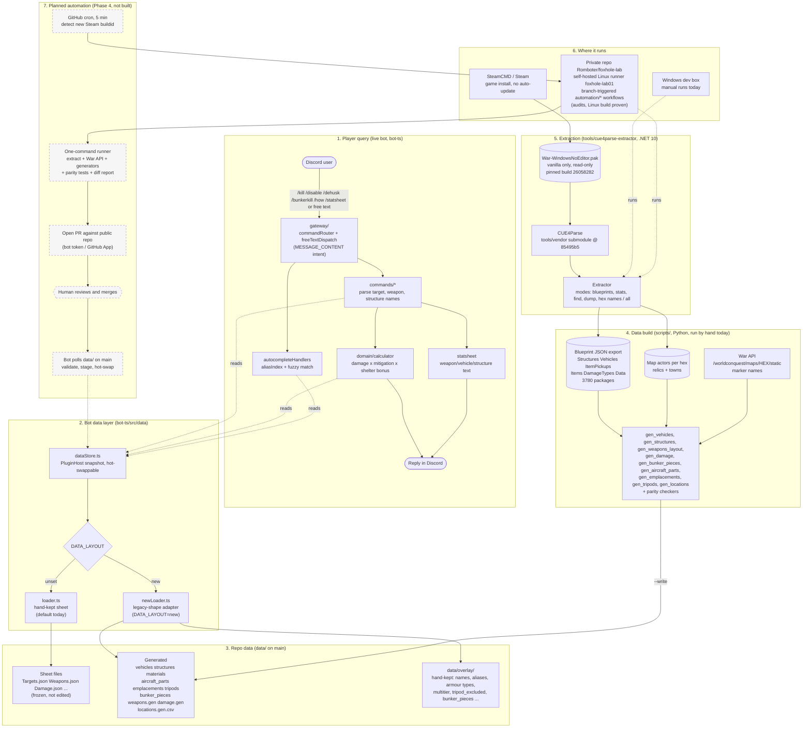

# End-to-end workflow: from a player's question to the game data behind it

Solid boxes are built. Dashed boxes are planned (Phase 4 spec, `docs/superpowers/specs/2026-10-31-phase4-automated-data-pipeline-design.md`).
Status as of 2026-11-08, branch `rewrite/node-ts`.

## Reading it

1. **Query path (top):** a Discord message or slash command goes through the gateway to a command, which reads the current data snapshot, runs the calculator or statsheet, and replies.
2. **Data layer:** the snapshot comes from one of two loaders. The hand-kept sheet is still the default; `DATA_LAYOUT=new` loads the generated files through the adapter, so the calculator and statsheet code is the same either way.
3. **Build path (bottom):** the PAK is read by CUE4Parse through our extractor, which writes the Blueprint JSON and map actors. Python generators turn those, plus War API marker names and hand overlays, into the `data/` files.
4. **Still manual:** every arrow from the extractor to `data/` is run by hand. The planned part is detection, a one-command runner, the PR, human review, and the bot picking up merged data without a restart.
